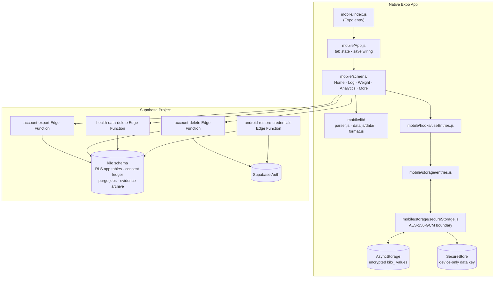

# Architecture

For engineers choosing the system contract to change. Runtime, persistence, sync,
and security contracts have focused owners below; each former section URL remains
a navigation entry. [Current State](product/current-state.md) owns release status.

Kilo is a single-path native app:

- `mobile/` is the active Expo/React Native app and receives all forward-looking
  architecture work.
- The legacy browser prototype (`Kilo.html`, `src/`, `tests/`) is archived under
  `docs/archive/browser-prototype/`. The Capacitor Android shell and its test
  configuration are no longer active.

## Architecture Overview

## Runtime Shape

See [Runtime Shape](architecture/native-runtime.md#runtime-shape).

## Screen Routing

See [Screen Routing](architecture/native-runtime.md#screen-routing).

## Exercise Library

See [Exercise Library](architecture/exercise-library.md).

## Tracked-lift lifecycle

See [Tracked-lift lifecycle](architecture/workout-analytics-ownership.md#tracked-lift-lifecycle).

## Session Check-In (Fatigue) Flow

See [Session Check-In (Fatigue) Flow](architecture/workout-analytics-ownership.md#session-check-in-fatigue-flow).

## Workout Analytics Ownership Contract

See [Workout Analytics Ownership Contract](architecture/workout-analytics-ownership.md#workout-analytics-ownership-contract).

### Ownership Principles

See [Ownership Principles](architecture/workout-analytics-ownership.md#ownership-principles).

### Field-by-Field Ownership Matrix

See [Field-by-Field Ownership Matrix](architecture/workout-analytics-ownership.md#field-by-field-ownership-matrix).

### Producer/Consumer Map

See [Producer/Consumer Map](architecture/workout-analytics-ownership.md#producerconsumer-map).

### Recomputation Rules

See [Recomputation Rules](architecture/workout-analytics-ownership.md#recomputation-rules).

### Acceptance Contract for Downstream Issues

See [Acceptance Contract for Downstream Issues](architecture/workout-analytics-ownership.md#acceptance-contract-for-downstream-issues).

## Parse-to-Persistence Flow

See [Parse-to-Persistence Flow](architecture/backup-and-save-flow.md#parse-to-persistence-flow).

## Persistence Model

See [Persistence Model](architecture/local-data-reference.md#persistence-model).

### AsyncStorage keys

See [AsyncStorage keys](architecture/local-data-reference.md#asyncstorage-keys).

## Entry Shapes

See [Entry Shapes](architecture/local-data-reference.md#entry-shapes).

### Weight entry

See [Weight entry](architecture/local-data-reference.md#weight-entry).

### Workout session (seeded)

See [Workout session (seeded)](architecture/local-data-reference.md#workout-session-seeded).

### Workout session (user-created)

See [Workout session (user-created)](architecture/local-data-reference.md#workout-session-user-created).

## Legacy note migration

See [Legacy note migration](architecture/local-data-reference.md#legacy-note-migration).

### Recovery lifecycle operation journal

See [Recovery lifecycle operation journal](architecture/recovery-state.md#recovery-lifecycle-operation-journal).

### Authoritative Recovery read state

See [Authoritative Recovery read state](architecture/recovery-state.md#authoritative-recovery-read-state).

## Ownership and reconciliation

See [Ownership and reconciliation](architecture/cloud-sync.md#ownership-and-reconciliation).

### Cloud sync pass cost

See [Cloud sync pass cost](architecture/cloud-sync.md#cloud-sync-pass-cost).

## Android Restore Credentials Trust Boundary

See [Android Restore Credentials Trust Boundary](security/account-security.md#android-restore-credentials-trust-boundary).

## Launch Abuse Boundary

See [Launch Abuse Boundary](security/account-security.md#launch-abuse-boundary).

## Health-Deletion Queue Monitor

See [Health-Deletion Queue Monitor](operations/health-deletion-operations.md#health-deletion-queue-monitor).

## Supabase Deployment Configuration

See [Supabase Deployment Configuration](operations/backend-activation.md#supabase-deployment-configuration).

## OTA Update Delivery

See [OTA Update Delivery](operations/mobile-builds.md#ota-update-delivery).

## Security Event Monitor

See [Security Event Monitor](security/security-monitoring.md#security-event-monitor).

## Testing Shape

See [Testing Shape](testing/test-coverage.md#automated-coverage-inventory).
