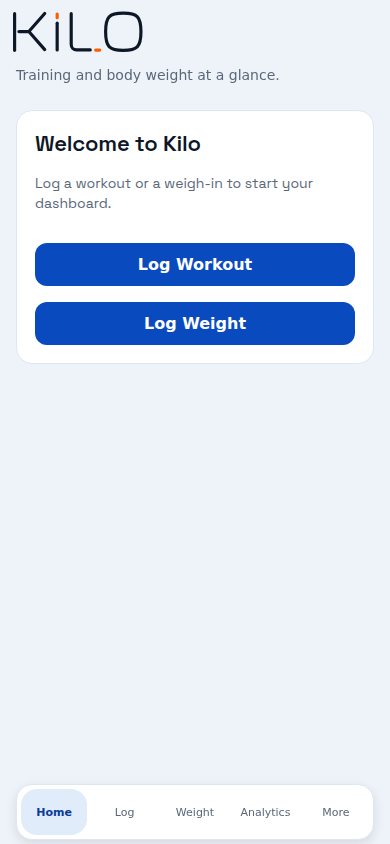
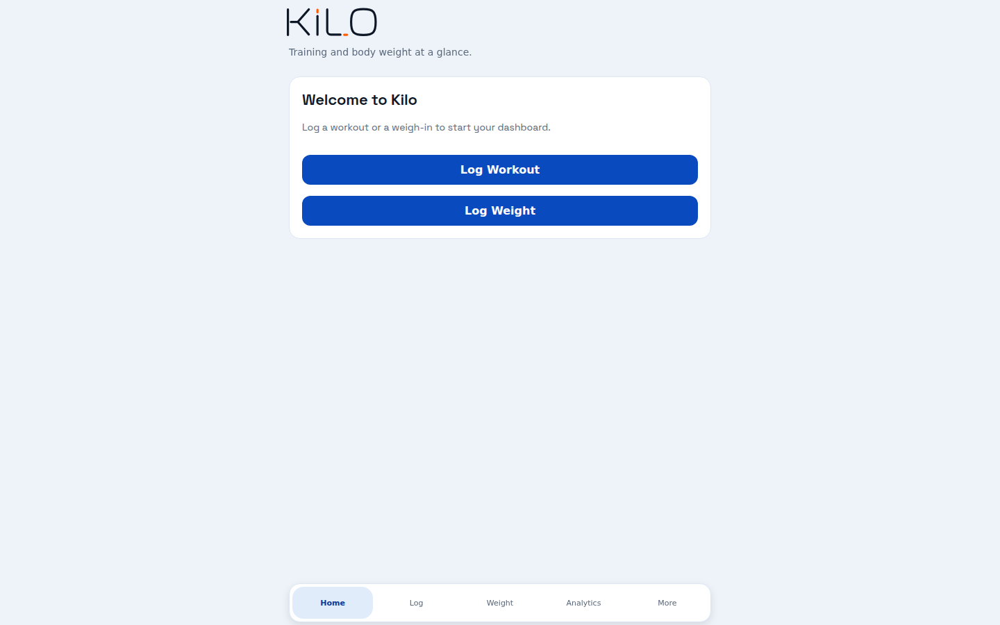
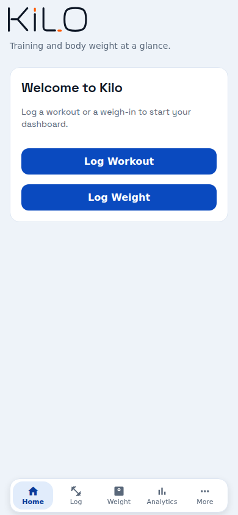
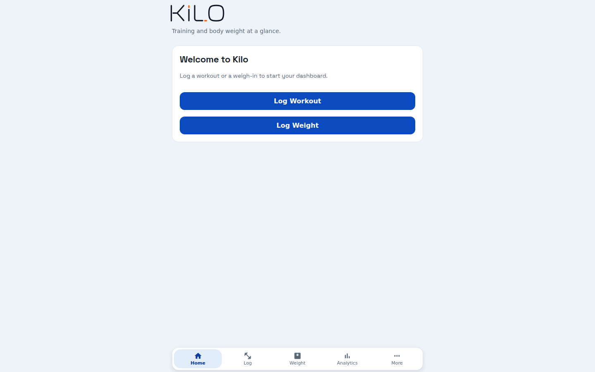

# Public web launch verification (#1548)

Captured 2026-10-21 with headless Chromium (Playwright `chromium-1243`) at
390×844 (mobile browser) and 1440×900 (desktop). Every run started with fresh
browser storage.

| Item | Value |
|---|---|
| Before | Production `https://kilo-app.pages.dev`, deployment of `main` @ `a1085ad2` |
| After | Cloudflare-built preview `https://issue-1548-web-launch.kilo-app.pages.dev` of branch commit `e46be0e7` (same build command as production) |
| Production URL | https://kilo-app.pages.dev |

Commits after `e46be0e7` on this branch change only documentation and this
evidence, so they cannot change the rendered app.

## Entry screen: before and after

| | 390×844 | 1440×900 |
|---|---|---|
| Before (production) |  |  |
| After (preview) |  |  |

**Before:** tab-bar icons are blank. Cloudflare Pages drops the uploaded
`assets/node_modules/…/MaterialIcons.ttf`, so the font URL returns
`index.html` (`content-type: text/html`), and the page throws "A network error
occurred."
**After:** the font is served from `assets/vendor_modules/…` as `font/ttf`, the
icons render, and no page errors are logged. Layout, type, spacing and colors
are otherwise unchanged. **Pass.**

## Local data, navigation, reload

Script: [`scripts/flow.mjs`](scripts/flow.mjs)
`node flow.mjs <url> <outdir> <width> <height>`

At both viewports on the preview:

- Logged a 182.4 lb weigh-in and saved the routine "Web Launch Check" (`-Bench 135 5,5,5`).
- Visited Home, Log, Weight, Analytics and More.
- Reloaded the page. Home showed 182.4 lb, Weight listed the entry, and Log listed the routine.
- No console errors, page errors or failed requests.

**Pass.** Data is in `localStorage` (`kilo_weight_entries`, `kilo_workout_notes`,
`kilo_local_data_owner`, and others).

Screenshots: `after-*-02-weight-saved.png`, `after-*-05-home-after-reload.png`,
`after-*-06-log-after-reload.png`.

## Hosting checks

`curl -D -` against `/` and the unknown path `/auth/callback` on the preview:
both return HTTP 200 with the app shell (`id="root"`), so the SPA fallback works.
Both carry the `_headers` CSP, `X-Frame-Options: DENY`, `X-Content-Type-Options:
nosniff`, `Referrer-Policy` and `Permissions-Policy`. **Pass.**

A direct upload with `wrangler pages deploy --branch issue-1548-upload-probe`
to the Git-connected `kilo-app` project created only a preview deployment
(`https://50707ff7.kilo-app.pages.dev`), and production was unchanged. This is
the method the deploy workflow uses. **Pass.**

## Rollback

Script: [`scripts/rollback.mjs`](scripts/rollback.mjs) uses one persistent
browser profile at 390×844 against `https://kilo-app.pages.dev`, with Cloudflare
rollback API calls between steps (2026-10-22).

| Step (UTC) | Production deployment | Live bundle | Weigh-in 177.7 after reload |
|---|---|---|---|
| 00:16:01 seed | `05d7a923` (`main` @ `a1085ad2`) | `index-a7506e33…` | present (`rollback-1-before.png`) |
| rollback to `59e66a50` (`main` @ `fce31aff`) | canonical switched; live in ~3 s | `index-0e5d1f1f…` | present (`rollback-2-rolled-back.png`) |
| roll forward to `05d7a923` | canonical switched; live in ~3 s | `index-a7506e33…` | present (`rollback-3-restored.png`) |

Production ended on the deployment it started on. The page errors logged in
these runs are the pre-existing icon-font failure that this PR fixes. **Pass.**
The workflow's redeploy-by-SHA path can be exercised only after merge.

## Authentication on the deployed origin

Script: [`scripts/auth2.mjs`](scripts/auth2.mjs)

| Case | Result |
|---|---|
| Turnstile loads on the preview origin | Pass. The `challenges.cloudflare.com` frame renders. |
| Password sign-in before the check passes | Pass. Shows "Complete the security verification before continuing."; no `/auth/v1/token` request is sent (`after-390x844-11-signin-unverified.png`). |
| Continue with GitHub | Pass. Redirects to `github.com/login` with `redirect_to=https://issue-1548-web-launch.kilo-app.pages.dev`. |
| Cancelled GitHub sign-in (`?error=access_denied`) | Partial. Stays signed out without crashing, but shows no message (`after-390x844-12-oauth-cancelled.png`). |
| Successful sign-in and callback return | Pass, by the owner on the deployed origin (2026-10-21). |
| Sign-out | **Fail.** "Could not revoke Android restore key. Sign out again to retry." The Edge Functions send no CORS allow-origin to browsers. Tracked in #1552; see [Web Deployment → Known web gaps](../../operations/web-deployment.md#known-web-gaps). |

## Native-only features

Data & Backup → Export Local Backup on desktop Chromium fails with the banner
"Export failed: Share is not supported in this browser" (Web Share API). It
does not crash, and the other screens stay usable. Recorded under Web
limitations in the runbook.
