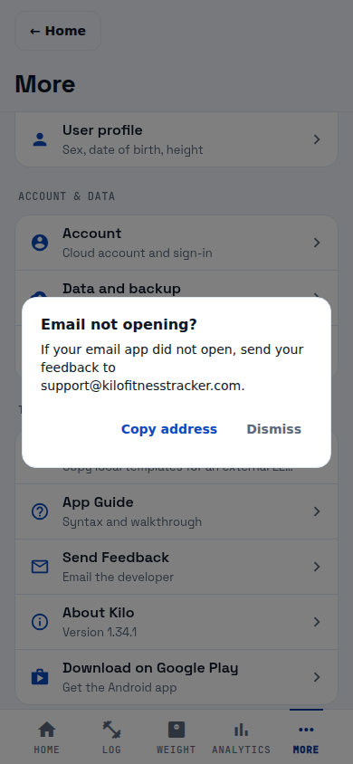

# Support email verification

Reference: [#1662](https://github.com/bpronin90/kilo/issues/1662). Original problem: Send Feedback and its copy fallback exposed the personal address `bpronin90@gmail.com`.

Layout checklist: preserve existing centered dialog, padding, font sizes, and Copy address / Dismiss actions; allow natural line wrapping; keep the complete support address readable without clipping at 390×844.

- Viewport: 390×844, Chromium, signed out, default light theme, More → Send Feedback → web fallback.
- Rendered source: parent `63c759c1473d19f8d7caad09165f44308bfa2bf7` with the issue #1662 one-line feedback-address replacement. The implementation commit containing this evidence has exactly this rendered product source; subsequent evidence-only commits cannot affect rendering.
- Capture: from `mobile/`, `APP_ENV=development EXPO_PUBLIC_APP_ENV=development npx expo start --web --port 8093`; from repo root, `node docs/evidence/support-email/capture.mjs http://localhost:8093`.
- The capture script uses the locally installed Playwright/Chromium paths; adjust those two paths on other machines. It prevents launching an external mail app and waits for the dialog animation.
- Comparison: PASS. The support address occupies its own readable line within the unchanged dialog. Both actions remain visible and unclipped.
- Tests: `npm test --prefix mobile -- --runInBand tests/more-screen.test.js` — 13 passed, including launch, missing handler, rejected launch/check, successful copy, and rejected copy.
