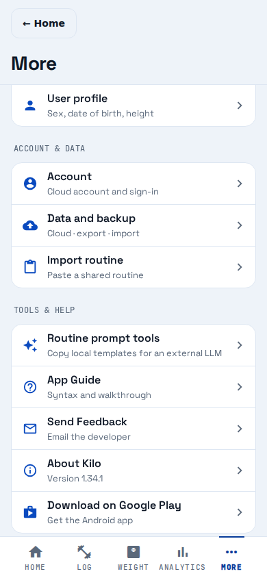

# Web Google Play option — visual verification

Reference: [issue #1660](https://github.com/bpronin90/kilo/issues/1660), its layout criteria, and the existing adjacent More menu rows in [MoreMenuPanels.js](../../../../mobile/screens/more/MoreMenuPanels.js).

Rendered product commit: `040131a35027b7f30249b17ccb62828eb3a3b3aa`.
Evidence-only follow-up commits do not change the rendered app or its dependencies.

Viewport: 390 × 844, Chromium headless. Fresh local state, walkthrough dismissed,
More tab, scrolled enough to show the complete Tools & help group.



PASS: the new row matches neighboring rows: aligned 22px leading icon, 16px title,
60px minimum row, shared borders and padding. Title and helper text fit without
truncation. Existing menu rows and bottom tabs retain their appearance. The link
is clear of the tab bar.

Browser verification also passed: accessible link has the exact Google Play
listing URL and opens a new tab while the original app stays open. External
navigation was intercepted to avoid relying on Play availability; this does not
verify listing publication or installation eligibility.

Reproduce from repo root with Playwright installed and its Chromium available:

```sh
npm run web:export
python3 -m http.server 8106 --bind 127.0.0.1 --directory mobile/dist
# In another terminal:
node docs/testing/evidence/1660/capture.cjs
```

If Playwright is installed outside the repository, set `PLAYWRIGHT_MODULE` to
its package path before the capture command. The capture script seeds only the
local walkthrough dismissal, navigates to More, saves the screenshot, and
checks new-tab navigation.

Other checks: 27 tests passed across `more-screen.test.js` and
`redesign-more-settings.test.js`, including web destination and Android/iOS
absence; web export, changelog validation and explicit Allowed Files scope
check passed.
