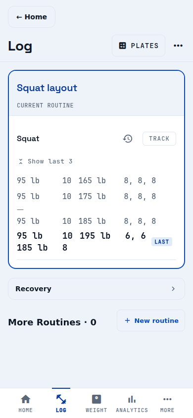
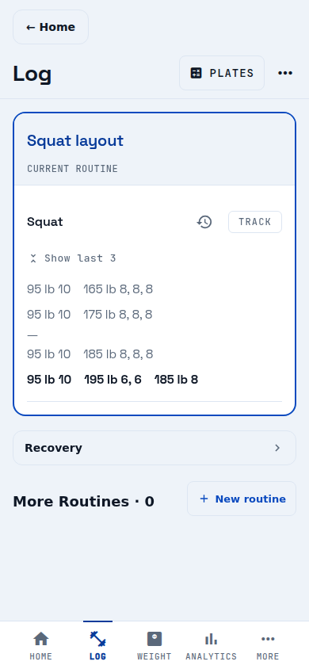

# Multi-weight session layout — issue #1647

The [reported Squat fixture and layout contract](https://github.com/bpronin90/kilo/issues/1647) are reproduced in the real Expo app, using its Log read view and exercise history sheet. The current routine is expanded to show every session. Captures use Chromium with mobile/touch emulation at **320 × 844** and **390 × 844** CSS pixels, DPR 1, in Hard Court light and dark modes. These are Android-sized phone viewports rendered by React Native Web; they are **not native Android screenshots**. The configured emulator has an older Kilo binary and was not used to claim native verification.

Before revision: `ff90c93a01b4c2cc92587a75679378b500dcb933`.
After rendering revision: the commit that adds the typography change to `mobile/components/log/LogExerciseRows.js` (the PR head's parent evidence commit; evidence files change no rendering). Captures were taken from the working tree of that commit on Expo web. Spacing-only captures from `d403952c` are superseded.

Layout checklist (expanded contract): one Space Grotesk family; day 16 >= exercise 16 >= every session 15; latest session bold (SpaceGrotesk-Bold) with no LAST text or badge; older sessions regular and muted; same newest-three fold and order; 4/16dp group gaps; no overflow.

## Before/after comparison

| Screen and viewport | Before | After |
| --- | --- | --- |
| Log, 320, light | [Before](before-log-320-light.png) | [After](after-log-320-light.png) |
| Log, 320, dark | [Before](before-log-320-dark.png) | [After](after-log-320-dark.png) |
| Log, 390, light | [Before](before-log-390-light.png) | [After](after-log-390-light.png) |
| Log, 390, dark | [Before](before-log-390-dark.png) | [After](after-log-390-dark.png) |
| History, 320, light | [Before](before-history-320-light.png) | [After](after-history-320-light.png) |
| History, 320, dark | [Before](before-history-320-dark.png) | [After](after-history-320-dark.png) |
| History, 390, light | [Before](before-history-390-light.png) | [After](after-history-390-light.png) |
| History, 390, dark | [Before](before-history-390-dark.png) | [After](after-history-390-dark.png) |

Before, the load column leaves excessive space before reps and a larger LAST-tagged latest session. After, each weight/reps pair is natural-width (4dp internal, 16dp between groups) and all sessions use 15dp Space Grotesk; the latest is bold only, with no LAST badge. History shows five entries including the skipped one, with the latest bolded. Day-heading fixture captures ([Log 320 dark](day-log-320-dark.png), plus 320/390 light/dark `day-*`) show the full hierarchy; [measured sizes](day-results.json): day 16, exercise 16, session 15, latest family `SpaceGrotesk-Bold`. **Pass** in all captures (the script asserts no overflow, gaps, size hierarchy and absence of LAST).




## Long content and enlarged text

The stress fixture appends one session containing `85kg` and sixteen reps. [Log](stress-log-320-dark.png) and [history](stress-history-320-dark.png) use 320 × 844 and 200% session text. Because web has no native accessibility font-size setting, the capture script doubles computed font sizes and line heights on rendered session text only. This is an explicit layout simulation, not native OS text-scale evidence.

The long group wraps internally and remains within the session width. All data is retained; vertical scrolling remains available. [Measured bounds](stress-results.json) confirm no horizontal overflow. [Normal measurements](after-results.json) check each group stays intact, internal spacing is 4px, same-line group spacing is 16px, and text remains within the session rail. Both runs have no page errors. **Pass** for the tested browser layout constraints; native Yoga/font-scale behavior remains unverified.

## Reproduction and tests

Use a fresh browser context. The script seeds only that disposable browser's local storage with the exact issue fixture, dismisses the tour, opens Log, expands earlier sessions, and opens Squat history. It never modifies device, account or production data.

```sh
cd mobile
APP_ENV=development EXPO_PUBLIC_APP_ENV=development npx expo start --web --port 8097
```

From another shell at the repository root, with Playwright available:

```sh
# Optional: set PLAYWRIGHT_MODULE to playwright-core's absolute index.mjs
# and CHROMIUM_PATH to an installed Chromium executable.
PHASE=after node docs/verification/multi-weight-session-layout/capture.mjs
PHASE=day DAY=1 node docs/verification/multi-weight-session-layout/capture.mjs  # adds a 'Monday — Upper' heading
PHASE=stress STRESS=1 node docs/verification/multi-weight-session-layout/capture.mjs
```

For before captures, run the unchanged capture script against the before revision's app with `PHASE=before`. Use an isolated checkout rather than replacing the implementation in a working branch.

```sh
npm --prefix mobile test -- --runInBand \
  tests/redesign-log-structure.test.js \
  tests/log-exercise-history-sheet.test.js \
  tests/log-presentation-refactor.test.js \
  tests/parser.test.js
```

Targeted suites (redesign-log-structure, log-exercise-history-sheet, log-presentation-refactor) pass: 39/39. Tests pin five sessions, group order in both surfaces, natural widths and gaps, no visible LAST (accessibility label "Latest session" kept), bold-only latest in one family at one size, and day >= exercise >= session sizes. Parser tests were not rerun; no parser change. Runtime: React Native Web in Chromium only; native Android/iOS rendering is unverified.
